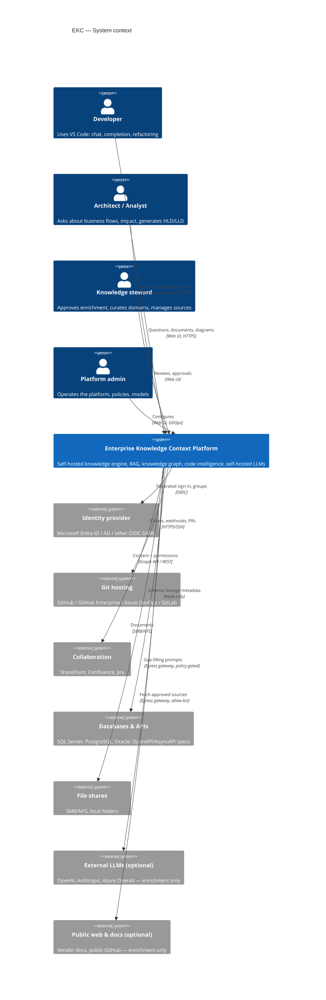
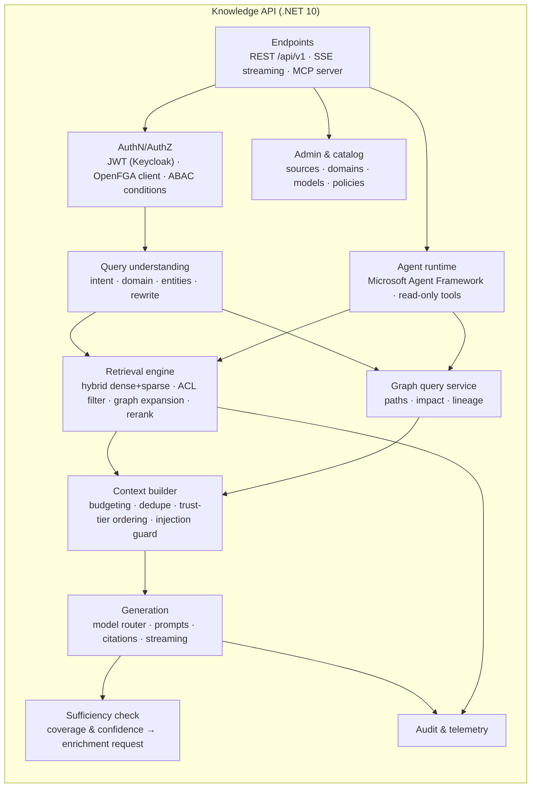
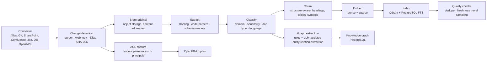
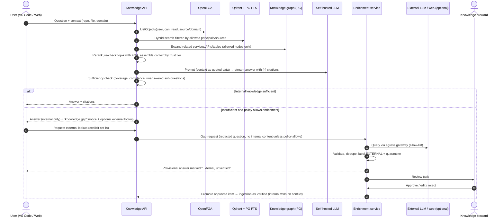

# 2. C4 model

Diagrams are Mermaid and render on GitHub and in VS Code (Markdown Preview Mermaid Support).

## 2.1 Level 1 — System context



## 2.2 Level 2 — Containers

```mermaid
C4Container
  title EKC — Containers

  Person(dev, "Developer")
  Person(user, "Analyst / Steward / Admin")

  System_Boundary(ekc, "EKC") {
    Container(vsx, "VS Code extension", "TypeScript", "Chat panel, @ekc participant, inline completion, code actions, search, MCP client config")
    Container(web, "Web portal", "React + TypeScript", "Ask, explore graph, review queue, sources, admin")
    Container(gw, "Edge gateway", "Traefik 3 / Gateway API", "TLS, routing, rate limits")
    Container(api, "Knowledge API", ".NET 10 ASP.NET Core", "Query/RAG orchestration, chat, search, graph queries, admin, MCP server")
    Container(ing, "Ingestion workers", ".NET 10 workers", "Connectors, sync, extraction, chunking, embedding, indexing, ACL sync")
    Container(code, "Code intelligence workers", ".NET 10 + tree-sitter/Roslyn/SCIP", "Parse repos into symbols, dependencies, call graphs, API surfaces")
    Container(enr, "Enrichment service", ".NET 10", "Gap detection, external lookup, validation, review workflow; the only container with egress")
    Container(docling, "Docling Serve", "Python", "PDF/DOCX/PPTX/XLSX/HTML to structured Markdown + tables, OCR")
    Container(llm, "Model runtime", "Ollama / vLLM / llama.cpp", "Chat, code, FIM completion models (OpenAI-compatible API)")
    Container(tei, "Embedding & rerank", "TEI or Ollama", "Dense/sparse embeddings, cross-encoder reranking")
    ContainerDb(pg, "PostgreSQL 18", "System of record", "Sources, documents, versions, chunks, ACLs, knowledge graph, jobs, chat, audit")
    ContainerDb(qd, "Qdrant", "Vector DB", "Dense + sparse vectors with ACL/tenant payload filters")
    ContainerDb(obj, "Object storage", "SeaweedFS (S3) / filesystem", "Original files, repo snapshots, exports")
    Container(nats, "NATS JetStream", "Messaging", "Ingestion events, work queues, webhooks fan-out")
    Container(kc, "Keycloak", "IdP broker", "OIDC for all clients, federates Entra ID/AD")
    Container(fga, "OpenFGA", "Authorization", "ReBAC/ABAC: who may read which source/document/repo/domain")
    Container(bao, "OpenBao", "Secrets", "Connector credentials, API keys, DB creds, transit encryption")
    Container(egress, "Egress gateway", "Envoy/Squid", "Allow-listed outbound for enrichment only")
    Container(obs, "Observability", "OTel Collector, Prometheus, Loki, Tempo, Grafana, Langfuse", "Metrics, logs, traces, LLM traces, evals")
  }

  Rel(dev, vsx, "Uses")
  Rel(user, web, "Uses")
  Rel(vsx, gw, "HTTPS, OIDC token")
  Rel(web, gw, "HTTPS, OIDC token")
  Rel(gw, api, "HTTP")
  Rel(api, pg, "SQL")
  Rel(api, qd, "gRPC")
  Rel(api, llm, "OpenAI-compatible HTTP")
  Rel(api, tei, "HTTP")
  Rel(api, fga, "Check / ListObjects")
  Rel(api, nats, "Publish")
  Rel(ing, nats, "Consume / publish")
  Rel(ing, docling, "Convert")
  Rel(ing, tei, "Embed")
  Rel(ing, obj, "Store originals")
  Rel(ing, pg, "Metadata, ACLs, graph")
  Rel(ing, qd, "Upsert vectors")
  Rel(ing, fga, "Write tuples (ACL sync)")
  Rel(ing, bao, "Read connector secrets")
  Rel(code, nats, "Consume repo events")
  Rel(code, pg, "Symbols, dependency graph")
  Rel(enr, egress, "Outbound only via")
  Rel(enr, pg, "Quarantine, reviews")
  Rel(api, kc, "JWKS / token validation")
```



**Why these boundaries**

- **Knowledge API vs. workers.** Query latency must not suffer during bulk indexing, so they scale independently.
- **Enrichment is its own container** because it is the *only* workload allowed to leave the network. Network policy enforces this, not just code.
- **Code intelligence is separate from document ingestion**: different parsers, much heavier CPU, and repository-level incremental logic.
- **Model runtime and embedding are infrastructure, not code.** Swapping Ollama for vLLM is a deployment change.

## 2.3 Level 3 — Knowledge API components



## 2.4 Level 3 — Ingestion pipeline components



## 2.5 Dynamic view — question with enrichment fallback



## 2.6 Dynamic view — inline completion in VS Code

```mermaid
sequenceDiagram
  autonumber
  participant ED as VS Code editor
  participant EXT as EKC extension
  participant API as Knowledge API
  participant CI as Code index (PG + Qdrant)
  participant FIM as FIM model (self-hosted)

  ED->>EXT: provideInlineCompletionItems (debounced 150–250 ms)
  EXT->>EXT: Local context: prefix/suffix, open tabs, imports (budgeted)
  EXT->>API: POST /api/v1/code/complete (repo id, path, prefix, suffix)
  API->>CI: Symbols referenced in prefix → definitions, coding-standard snippets (cached)
  API->>FIM: FIM prompt (prefix + retrieved snippets + suffix), max 64–128 tokens
  FIM-->>API: Completion
  API-->>EXT: Completion (+ trace id)
  EXT-->>ED: Ghost text; accept/reject telemetry (no code stored by default)
```
