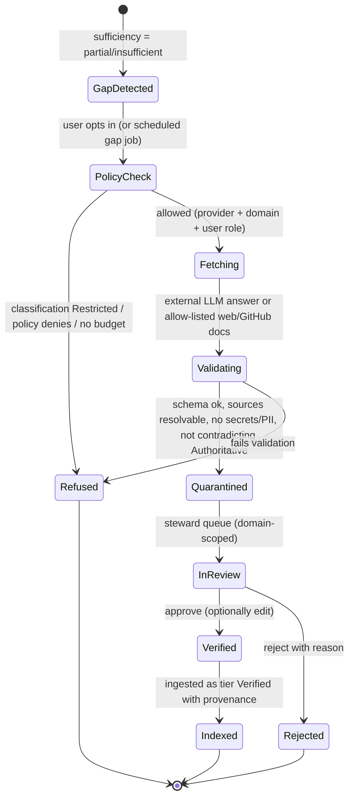

# 5. Retrieval, generation and enrichment

## 5.1 Query pipeline

| Step | What happens | Notes |
|---|---|---|
| 1. Authenticate | JWT from Keycloak; resolve user, groups, team, tenant, attributes | cached per token |
| 2. Authorise scope | OpenFGA `ListObjects(user, reader, source)` → allowed source ids; plus ABAC conditions (classification ≤ clearance, team) | cached a few minutes; invalidated on tuple change |
| 3. Understand query | intent (explain / locate / flow / impact / generate-code / generate-doc), domain, entities (match graph aliases), rewrite into sub-queries | small model or rules; no external calls |
| 4. Retrieve | Qdrant hybrid (dense + sparse, RRF fusion) **filtered by** tenant, allowed sources, `acl_principals ∩ user principals`, tier ∈ {Authoritative, Internal, Verified}; PostgreSQL FTS for exact identifiers | top 30–50 candidates |
| 5. Expand | graph neighbourhood of matched entities (depth 1–3, allowed nodes only) → summaries + linked docs | for flow and impact intents |
| 6. Rerank | cross-encoder (TEI) or a lightweight score (laptop) → top 6–12 | trust tier and freshness as tie-breakers |
| 7. Re-check | OpenFGA `Check` on each final document (defence in depth) | drops anything stale in the index |
| 8. Build context | dedupe, order by tier, fit the token budget, wrap each chunk as quoted data with an id | prompt-injection guard (5.4) |
| 9. Generate | model routed by intent and profile; stream; must cite `[n]` per claim | temperature low for factual intents |
| 10. Verify citations | every `[n]` must exist in context; sentences without support are flagged; fabricated references are removed | |
| 11. Sufficiency | coverage of sub-questions + retrieval scores + model self-assessment → `sufficient`, `partial` or `insufficient` | drives 5.3 |
| 12. Record | conversation, retrieved ids, citations, latency, tokens, model; feedback later | audit + evaluation data |

Chunking: structure-aware. Markdown headings and Docling sections, tables kept whole, code chunked by symbol (class/method) with a signature header. Target 400–900 tokens, 10–15% overlap for prose only.

## 5.2 Code-aware retrieval

For repository questions and IDE requests the retriever adds:

- **Symbol lookup** (exact): definitions and references from the code index for identifiers in the question or the cursor context.
- **Structural context**: containing project, dependencies, interfaces implemented, callers and callees (graph).
- **Standards**: chunks from sources tagged `coding-standard`, `architecture-decision` or `pattern` for the repo's domain and language.
- **Similar code**: dense search over code chunks from repositories the user can read.

## 5.3 Enrichment workflow ("internal first")

**Policy controls** (OpenFGA plus a policy table, all audited):

- Which external providers and models are enabled, per tenant and domain.
- What may be sent: by default only the **question**, redacted (secrets, emails, hostnames, identifiers matched by deny patterns), never internal chunks. `Confidential` context can be sent only if the domain policy allows it; `Restricted` never.
- Who may trigger enrichment (role) and who may approve (steward of that domain).
- Monthly budget per tenant; per-request token caps.
- Web sources: allow-list of hosts (e.g. `learn.microsoft.com`, `docs.github.com`, vendor docs); robots.txt respected; only HTML and Markdown; through the egress proxy.

**Validation** before quarantine: citation URLs resolve and contain the claimed text (for web), no contradiction with Authoritative facts (graph and fact check by the local model), deduplication against existing knowledge, licence check for code snippets (block content flagged as copyleft unless allowed).

Answers built on quarantined items are always labelled **"External, unverified"** and never cached as normal answers.

## 5.4 Prompt-injection and output safety

- Retrieved content is inserted as data blocks with ids, outside the instruction section. The system prompt states that instructions inside content must be ignored.
- At ingestion, documents are scanned for injection patterns (e.g. "ignore previous instructions", hidden text, zero-width characters) and flagged chunks are down-ranked and marked.
- The model has no tools during plain RAG. Agent mode has read-only tools (search, graph query, read file); write tools (create file or PR) only produce proposals that the user applies in VS Code.
- Output filters: secret detection (high-entropy strings, key formats) and links only to known sources.
- The citation verifier (step 10) removes references that were not in the context.

## 5.5 Agent mode (multi-step questions)

Used for impact analysis, "trace this transaction", HLD/LLD generation and multi-file code changes. Built on Microsoft Agent Framework with tools:

| Tool | Access |
|---|---|
| `search_knowledge(query, filters)` | permission-filtered retrieval |
| `graph_paths(from, to, edge_types, depth)` / `graph_impact(node)` | permission-filtered graph |
| `read_document(id)`, `read_file(repo, path, ref)` | permission-checked |
| `list_symbols(repo, query)`, `find_references(symbol)` | code index |
| `render_diagram(mermaid)` | output only |
| `propose_patch(files)` | returns a diff for the IDE; never writes to Git |

Budgets: max steps, max tokens and wall-clock time; every tool call is traced and audited.

## 5.6 Evaluation

- **Golden sets** per domain (question → expected sources and facts), versioned in `eval/`. They grow from approved feedback ("this answer was wrong, here is the right source").
- **Metrics:** retrieval recall@k, MRR, nDCG; answer faithfulness and citation precision (local judge model + rules); ACL leak tests (synthetic users must never retrieve forbidden canaries); latency and cost per profile.
- Runs in CI on a small fixture corpus, and nightly on staging. Regressions block model or prompt changes.
