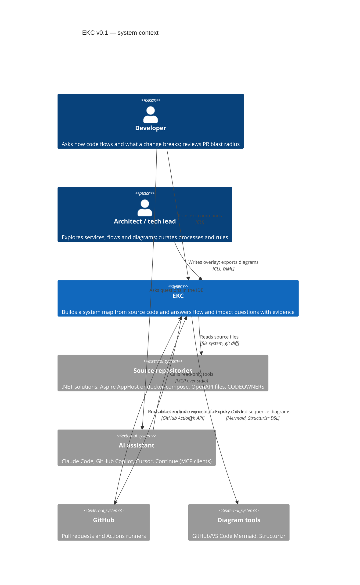
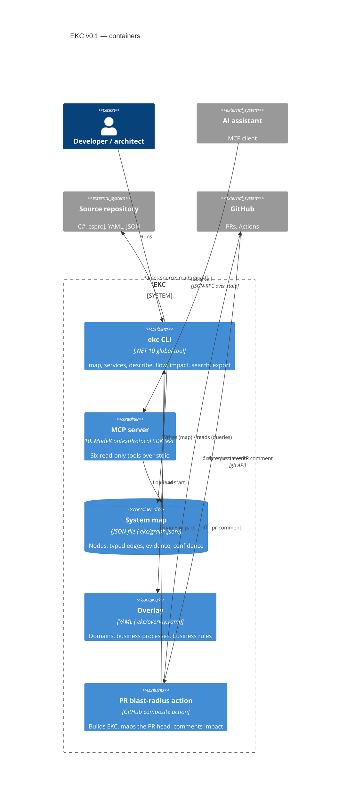
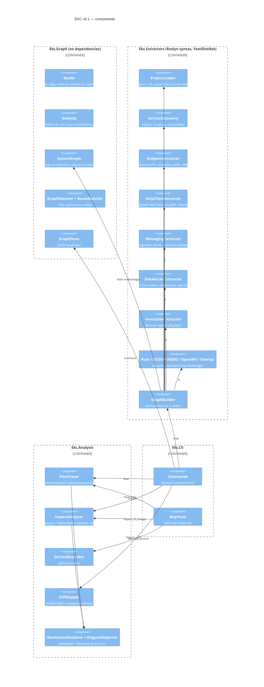
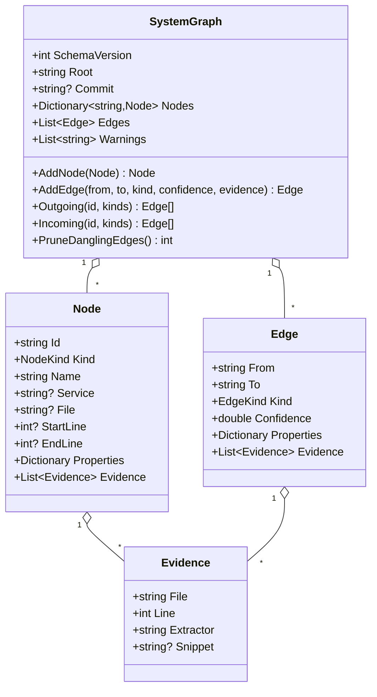
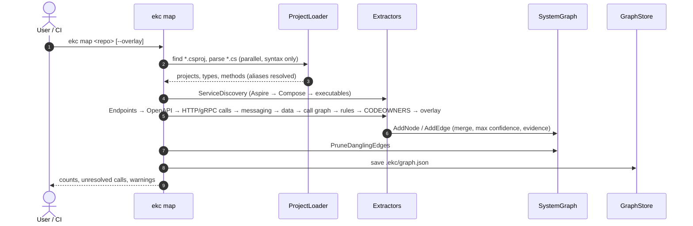
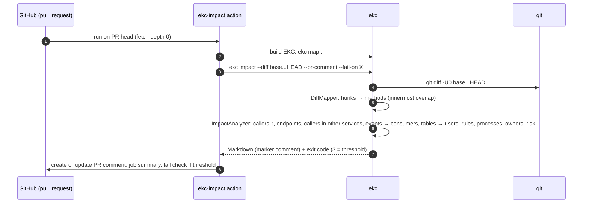
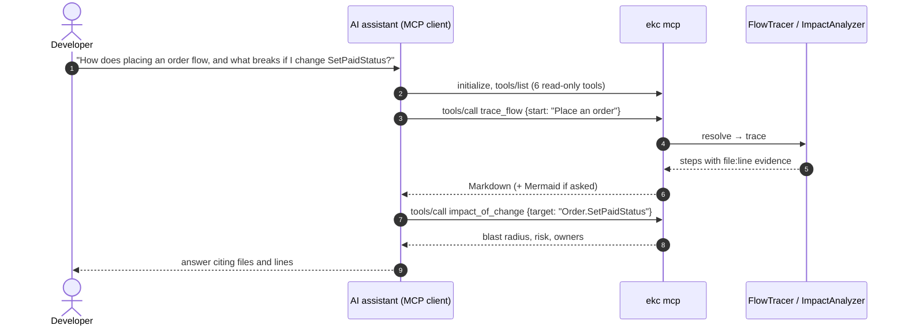

# EKC architecture (as built, v0.1)

This document describes the system **as implemented** in this repository. The documents `01`–`08` in this folder describe the longer-term target platform. v0.1 is that platform's *system graph* core, shipped first as a zero-infrastructure tool.

| | |
|---|---|
| Version | 0.1.0 |
| Scope | .NET estates; CLI, MCP server, PR action |
| Diagrams | Mermaid C4 (renders on GitHub) + Structurizr DSL in [`ekc-workspace.dsl`](ekc-workspace.dsl) |

## 1. Purpose

EKC builds a **system map** of a software estate from source code: services, endpoints, calls, events, data, business rules and owners, with evidence for every fact. It answers two questions:

1. **How does this flow?** A request, event or business process, across services.
2. **What could break if this changes?** Endpoints, callers in other services, event consumers, shared tables, business rules, processes and owners.

It answers people through the CLI, PR comments and diagrams, and AI assistants through MCP.

**Design constraints:**
- No build, restore or runtime access to the target system.
- No database or GPU.
- Runs on a developer laptop or a CI runner in seconds.
- Every edge carries evidence (file:line) and a confidence score.

## 2. C4 level 1 — System context

EKC never calls an LLM itself. The AI assistant, whichever the user chooses, calls EKC; so the map and the analysis stay entirely local.

## 3. C4 level 2 — Containers

| Container | Code | Notes |
|---|---|---|
| ekc CLI | `src/Ekc.Cli/Program.cs` | System.CommandLine 2.0; packaged as the `Ekc.Cli` .NET tool, command `ekc` |
| MCP server | `src/Ekc.Cli/McpTools.cs` | the same executable (`ekc mcp`); logs to stderr, protocol on stdout |
| System map | `src/Ekc.Graph/GraphStore.cs` | one JSON file; schema version checked on load |
| Overlay | `src/Ekc.Extractors/Common/OverlayExtractor.cs` | optional; resolved against the graph, unresolved steps reported as warnings |
| PR action | `.github/actions/ekc-impact/action.yml` | exit code 3 = risk threshold reached |

## 4. C4 level 3 — Components

**Dependency rule:** `Ekc.Graph` ← `Ekc.Extractors` / `Ekc.Analysis` ← `Ekc.Cli`. Analysis never depends on extractors, so a map built elsewhere (CI, another language's extractor) can be analysed anywhere.

## 5. C4 level 4 — Code: the graph model

### Node kinds

| Kind | Id format | Created by |
|---|---|---|
| Service | `service:{name}` | Aspire `AddProject`/`AddDotnetProject`, Compose `build`, executable projects |
| Endpoint | `endpoint:{service}:{VERB} {/normalised/path}` / `…:GRPC {Service}/{Rpc}` | minimal APIs, controllers, gRPC, YARP forwarders, OpenAPI |
| Method | `method:{project}:{Namespace.Type}.{Name}/{paramCount}` | every method; top-level programs (`<Main>`), local functions and endpoint lambdas as synthetic methods |
| Topic | `topic:{EventType}` | integration-event types, subscriptions, consumers |
| Table | `table:{DbContext}.{Entity}` | `DbSet<T>` + `ToTable` |
| Resource | `resource:{name}` | Aspire/Compose resources (databases, brokers, caches, gateways), external hosts |
| Team | `team:{owner}` | CODEOWNERS |
| BusinessRule | `rule:{slug}` | `[BusinessRule]`, `// ekc:rule`, overlay |
| BusinessProcess, Domain | `process:{slug}`, `domain:{slug}` | overlay |

### Edge kinds

| Edge | From → To | Confidence |
|---|---|---|
| Exposes | Service → Endpoint | 1.0 |
| ImplementedBy | Endpoint → Method | 1.0 |
| CallsEndpoint | Method/Endpoint → Endpoint | 0.9–0.95 matched route; 0.5 if several candidates tie |
| CallsService | Method → Service/Resource | 0.6 (URL built at runtime) |
| Publishes | Method → Topic | 0.85 (event created in the method) |
| Subscribes / HandledBy | Service → Topic / Topic → Method | 1.0 |
| Dispatches | Method → handler Method | 0.85 (command/notification created → its handler) |
| Invokes | Method → Method | 0.9 same type; 0.85 receiver-typed; 0.7 unique name; 0.4 ambiguous |
| ReadsTable / WritesTable | Method → Table | 0.8 EF; 0.6 raw SQL |
| UsesResource / DependsOn | Service → Resource / Service | 1.0 `WithReference`; 0.7 other relations |
| StoredIn | Table → Resource | 0.7 |
| OwnedBy / PartOfDomain / EnforcedBy / ProcessStep | ownership and business layer | 1.0 (0.95 rule comments) |

## 6. Runtime views

### 6.1 Building the map (`ekc map`)

Extractor order matters. Endpoints must exist before calls are matched to them, and overlay steps are resolved last, against the finished graph.

### 6.2 Pull-request blast radius

### 6.3 AI assistant question (MCP)

## 7. Analysis algorithms

**Flow tracing** (`FlowTracer`) walks forward from an endpoint, topic, method or process:
- endpoint → handler → significant outgoing edges, in source-line order: HTTP/gRPC calls (continue into the target endpoint), publishes (continue into each consumer), dispatches, and table reads/writes;
- internal `Invokes` chains are kept only if they lead to something significant;
- confidence multiplies along the path; edges below 0.5 are ignored;
- depth and step limits prevent explosion; nodes are visited once.

**Impact analysis** (`ImpactAnalyzer`) starts from the changed methods (or a non-method target), then finds:
1. **upstream callers:** reverse `Invokes`/`Dispatches`, depth 6;
2. **endpoints** implemented by any affected method;
3. **callers of those endpoints** in other services, and the endpoints of those services that reach the call;
4. **events** the changed code (or the handlers it dispatches to) publishes, and their consumers;
5. **tables** it writes, and the other code that reads or writes them;
6. **business rules** enforced by affected code, the **processes** that include any affected endpoint, topic or method, and the **teams** owning affected services.

Risk is **High** if anything crosses a service boundary (callers, event consumers, shared data) or touches a business rule; **Medium** if only endpoints inside the service change; **Low** otherwise.

## 8. Architecture decisions

| # | Decision | Rationale | Consequence |
|---|---|---|---|
| 1 | **Syntax-only Roslyn**, no compilation | works on any checkout without restore/build, private feeds or SDK versions; seconds, not minutes | types are inferred from declarations; heuristic links carry confidence < 1 |
| 2 | **Deterministic extraction first**, LLM never required | answers must be provable; runs offline and on CPU | business processes need the overlay (or later, LLM suggestions that stay quarantined) |
| 3 | **Evidence + confidence on every edge** | reviewers can verify; risky guesses are visible | output is longer; UI collapses low-confidence detail |
| 4 | **Single JSON file** as the store | zero infrastructure; diffable; CI-friendly | whole graph in memory (fine to ~10⁶ edges); server store is a later option |
| 5 | **One executable** for CLI and MCP | one install; identical answers for people and assistants | MCP serves one graph per process (run one server per estate) |
| 6 | **MCP over stdio, read-only tools** | works with every major assistant; no network exposure | remote/shared MCP (HTTP + auth) arrives with server mode |
| 7 | **Overlay YAML** for business knowledge | code can't express processes; keep curation in git, reviewed like code | needs owners to maintain it; steps are validated on every map |
| 8 | **Analysis independent of extractors** | other languages can produce the same graph | node/edge schema is a public contract (schema version 1) |
| 9 | **Apache-2.0** | adoption in enterprises; compatible with all dependencies | — |

## 9. Quality attributes (measured)

| Attribute | Measurement (2017 MacBook Pro, i7 2C/4T, 16 GB) |
|---|---|
| Time to map dotnet/eShop (19 projects, 474 files) | 2.5–10 s (warm vs. cold start) |
| Memory | < 1 GB |
| eShop extraction | 9 services, 45 endpoints, 13 events, 9 tables; every cross-service HTTP/gRPC call resolved except 2 runtime-built URLs (reported, not guessed); event pub/sub matrix matches the real architecture |
| Tests | 47 (unit + end-to-end on the Fabrikam sample) |
| MCP | protocol 2025-06-18; 6 tools, all `readOnlyHint` |

## 10. Known limitations

| Limitation | Effect | Planned mitigation |
|---|---|---|
| URLs from configuration or helper methods | call resolves to the service, not the endpoint | read `appsettings*.json`/environment; follow helper returns (v0.2) |
| `var` locals and interface-typed fields with many implementations | lower-confidence or missing `Invokes` | lightweight local type inference; DI registration mapping (v0.2) |
| Reflection, dynamic dispatch, generic message buses with `Publish<T>` | missed edges | pattern library for MassTransit/NServiceBus/Wolverine (v0.2) |
| .NET only | — | Java (Spring) pack, then TypeScript/Python (v0.3+) |
| One repository per map | cross-repo estates need merging | `ekc merge` / multi-root map (v0.3) |

## 11. Relation to the target platform

The target architecture (`01`–`08`) adds identity (Keycloak/Entra), fine-grained permissions (OpenFGA), document RAG, governed enrichment and a server deployment. v0.1 provides the system graph that every one of those capabilities queries. The graph schema, resolver and analysis carry over unchanged; the store moves from a JSON file to PostgreSQL in server mode.
